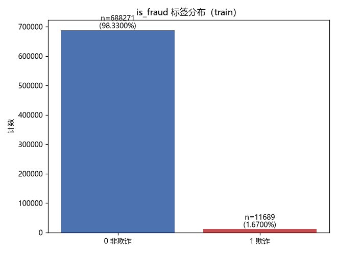

# Kaggle Playground S6E11 — 信用卡欺诈识别

二分类任务：预测每笔交易为欺诈（`is_fraud`）的概率，评估指标为 ROC AUC。
训练集 699,960 行 × 26 列，测试集 299,984 行 × 25 列，欺诈率 1.67%。

> **TL;DR**：24 个原始特征 + 加性 LightGBM（depth=1）为单模型基线；与 depth2 的 50/50 融合（v18）和三种子平均（v23）为最终提交。
>
> **CV OOF 0.9481 · Public LB 0.94810 / 0.94803 · 23 组实验（统一登记，顺序见 `results/experiment_log.csv` 时间戳）**
>

> 公开 LB 上已有 0.953 量级的方案，与本项目相差约 5e−3，差距来源未确认，见「主要发现」。

## 结果

| 提交 | 说明 | CV（OOF） | Public LB |
|---|---|---|---|
| v18 | LightGBM depth1 + depth2，0.5/0.5 概率平均 | 0.948114 | 0.94810 |
| v23 | v18 在 CV 种子 42/666/789 上的等权 logit 平均 | 0.948201* | 0.94803 |

\* 跨种子 OOF 对平均版本略偏乐观；单种子干净均值为 0.948016。两个提交均作为 Final Submission。

### 关键实验（v17–v23）

| 实验 | 方法 | CV（OOF / mean fold） | 结论 |
|---|---|---|---|
| v17 | LightGBM stumps（depth=1） | 0.947715 / 0.947746 | 单模型基线 |
| v18 | stumps + depth2，0.5/0.5 | 0.948114 / 0.948142 | 最终提交 |
| v19 | CatBoost depth2 | 0.946365 / 0.946437 | 弱于基线 |
| v20 | 分箱/样条加性逻辑回归 | 0.945848 / 0.945875 | 弱于基线 |
| v22 | XGBoost depth2 | 0.947542 / 0.947563 | 与 v17 持平 |
| v23 | v18 三种子平均 | 0.948201* / 0.948209 | 最终提交（降方差） |

v21（二级集成）未达采纳门槛（0.948103 / 0.948160，t≈1.0），未采用。

## 方法

### 数据与 EDA
- 13 个数值列、5 个分类列、6 个布尔列，无缺失值。
- 单变量信号强且近似单调：`cvv_retry_count≥2` 的欺诈率 41.7%、`ip_country_mismatch` 16.5%、`velocity_score` 与 `merchant_risk_score` 的最高分箱约 5.3%/5.5%。
- 交互筛查（精确 OR、SHAP 交互）未发现实质交互；欺诈的对数几率近似可加。




### 特征工程

14 组特征实验按"对树模型是否有信息增量"分为两类，不混在一起解读：

| 类别 | 组数 | 实验 | 说明 |
|---|---|---|---|
| **信息等价变换（噪声对照）** | 8 | v11/v12 `log1p`；v03/v04 `hour/day` 的 sin-cos；v05/v06/v14 阈值标志；v13 类别风险标志 | 对树模型切分点集合不变，或等价于在类别列上切，理论上增量为零。保留它们是为了标定配对检验的假阳性水平，**不作为"特征是否充分"的证据**。 |
| **真检验** | 6 | v07 布尔和；v08/v09/v15 交互项；v16 折内目标编码（5 个类别列） | 含有原特征不可直接表达的信息，是真正在检验"是否还有增量"。 |

结论：真检验的 6 组里，OOF 变化都在 ±3e−4 以内，没有一组通过采纳门槛（t≥2.776 且 ≥4/5 折为正）。
这个结论只覆盖手工艺特征，不覆盖模型族与特征规模——后者见「主要发现」最后一条。

### 模型
- 单模型：LightGBM 加性 stumps（depth=1）优于 31 叶树（CV 0.9477 vs 0.9463），说明交互容量主要带来过拟合。
- 集成：stumps + depth2 各 50%（v18），在 3 个 CV 种子上均优于两个单模型。
- 多种子：v18 在种子 42/666/789 上等权平均（v23），降低对单次折划分的依赖。
- 对照实验：CatBoost、XGBoost、分箱/样条加性逻辑回归、二级 stacking 均未超过 LightGBM 基线。

### 验证协议
- `StratifiedKFold(n_splits=5, shuffle=True)`；主种子 42，复核种子 123/777，多种子 666/789。
- 每次实验记录 mean train AUC、mean val AUC、train−val gap、val AUC std。
- 判定使用同折配对 t 检验（t≥2.776、≥4/5 折为正），并要求多种子方向一致；详见 `docs/methodology.md`。
- 所有含标签统计（目标编码等）仅在当前折训练部分内拟合。

## 仓库结构

```
src/            最终流水线：config、EDA、v17、v18、v23、产物校验、run_all（一键复现）
experiments/    关键对照实验：v19–v22、容量曲线、编码网格
archive/        历史特征实验 v01–v16（保留出处，不属于最终流水线）
results/        实验日志与小结果表
docs/           验证方法与图表
submissions/    最终提交（v18、v23）
```

## 复现

比赛数据不包含在本仓库中（Kaggle 规则不允许再分发）。

1. 从 [Kaggle 比赛页](https://www.kaggle.com/competitions/playground-series-s6e11) 下载 `train.csv`、`test.csv`、`sample_submission.csv`，放入 `data/`（`run_all.py` 会先校验列数）。
2. 安装依赖：`pip install -r requirements-lock.txt`（或 `requirements.txt`）。
3. 一键复现：

```bash
python src/run_all.py                  # v02 → v17 → v18 → v23，约 60 分钟（8 核）
python src/run_all.py --through v17    # 只到单模型基线，约 17 分钟
```

依赖链：v17 的配对基准是 v02 的 OOF；v18 复用 v17 的 OOF 与提交文件；v23 复用 v18 的成员配置。
`outputs/` 是中间产物（不纳入版本控制），由 `run_all.py` 创建并在每阶段结束后校验。

## 主要发现

- **特征工程的边界**：14 组特征实验按"对树模型是否有信息增量"分为两类——8 组是信息等价变换，理论上增量为零，只能作噪声对照；真正有效的检验是 6 组，在这 6 组上未见可复现增量（见「方法 · 特征工程」）。
- 树的交互容量是主要过拟合来源：depth 1 的 train-val gap 为 0.0018，31 叶为 0.0138；容量曲线在 depth≥3 后开始下降。
- 四种 GBDT/线性成员之间不产生新信息：OOF 相关系数 0.97–0.99（未测试神经网络族）。
- 在 24 个原始特征 + 树模型族内，剩余优化空间约 1e−4。


## 限制

- 数据为 Kaggle 合成的比赛数据，未使用外部数据；结论不保证迁移到真实交易流。
- Early stopping 使用验证折选择轮数，CV 分数略偏乐观；嵌套审计约 +5e−4（且嵌套只用 68% 数据）。
- Public LB 仅覆盖测试集的一个子集，单次分数有抽样波动（本项目的估计为 2–3e−3），
  因此"CV 与 Public 差 1.4e−5"只能算弱证据，不足以证明协议无偏。
- 与公开 LB 上 0.953 量级方案之间约 5e−3 的差距未确认来源；本项目不声称已接近该任务的上限。

## 许可证

代码使用 MIT License。比赛数据版权归 Kaggle，未包含在仓库中。
