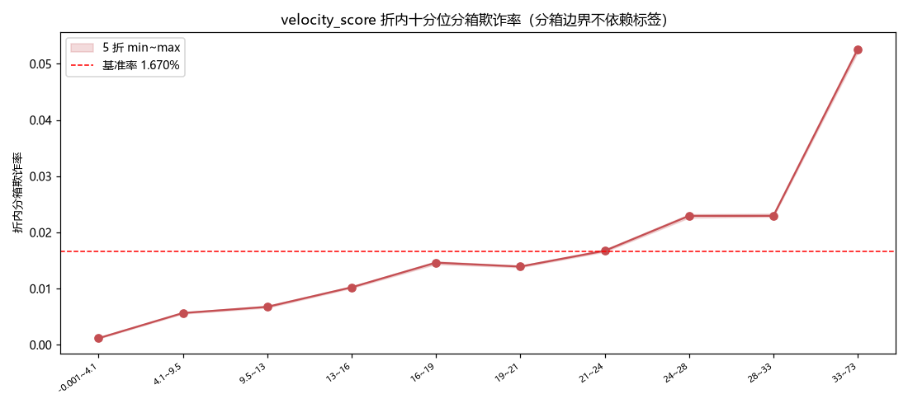

# Kaggle Playground S6E11 — 信用卡欺诈识别

二分类任务：预测每笔交易为欺诈（`is_fraud`）的概率，评估指标为 ROC AUC。
训练集 699,960 行 × 26 列，测试集 299,984 行 × 25 列，欺诈率 1.67%。

> **TL;DR**：24 个原始特征 + 加性 LightGBM（depth=1）为单模型基线；与 depth2 的 50/50 融合（v18）和三种子平均（v23）为最终提交。
>
> **CV OOF 0.9481 · Public LB 0.94810 / 0.94803 · 23 个预注册实验 · CV–LB 差距 1.4e−5**

## 结果

| 提交 | 说明 | CV（OOF） | Public LB |
|---|---|---|---|
| v18 | LightGBM depth1 + depth2，0.5/0.5 概率平均 | 0.948114 | 0.94810 |
| v23 | v18 在 CV 种子 42/666/789 上的等权 logit 平均 | 0.948201* | 0.94803 |

\* 跨种子 OOF 对平均版本略偏乐观；单种子干净均值为 0.948016。两个提交均作为 Final Submission。

### 关键实验（v17–v23）

| 实验 | 方法 | CV（OOF / mean fold） | 结论 |
|---|---|---|---|
| v17 | LightGBM stumps（depth=1） | 0.947715 / 0.947746 | 单模型基线 |
| v18 | stumps + depth2，0.5/0.5 | 0.948114 / 0.948142 | 最终提交 |
| v19 | CatBoost depth2 | 0.946365 / 0.946437 | 弱于基线 |
| v20 | 分箱/样条加性逻辑回归 | 0.945848 / 0.945875 | 弱于基线 |
| v22 | XGBoost depth2 | 0.947542 / 0.947563 | 与 v17 持平 |
| v23 | v18 三种子平均 | 0.948201* / 0.948209 | 最终提交（降方差） |

v21（二级集成）未达采纳门槛（0.948103 / 0.948160，t≈1.0），未采用。

## 方法

### 数据与 EDA
- 13 个数值列、5 个分类列、6 个布尔列，无缺失值。
- 单变量信号强且近似单调：`cvv_retry_count≥2` 的欺诈率 41.7%、`ip_country_mismatch` 16.5%、`velocity_score` 与 `merchant_risk_score` 的最高分箱约 5.3%/5.5%。
- 交互筛查（精确 OR、SHAP 交互）未发现实质交互；欺诈的对数几率近似可加。




### 模型
- 单模型：LightGBM 加性 stumps（depth=1）优于 31 叶树（CV 0.9477 vs 0.9463），说明交互容量主要带来过拟合。
- 集成：stumps + depth2 各 50%（v18），在 3 个 CV 种子上均优于两个单模型。
- 多种子：v18 在种子 42/666/789 上等权平均（v23），降低对单次折划分的依赖。
- 对照实验：CatBoost、XGBoost、分箱/样条加性逻辑回归、二级 stacking 均未超过 LightGBM 基线。

### 验证协议
- `StratifiedKFold(n_splits=5, shuffle=True)`；主种子 42，复核种子 123/777，多种子 666/789。
- 每次实验记录 mean train AUC、mean val AUC、train−val gap、val AUC std。
- 判定使用同折配对 t 检验（t≥2.776、≥4/5 折为正），并要求多种子方向一致；详见 `docs/methodology.md`。
- 所有含标签统计（目标编码等）仅在当前折训练部分内拟合。

## 仓库结构

```
src/            最终流水线：config、EDA、v17、v18、v23、产物校验
experiments/    关键对照实验：v19–v22、容量曲线、编码网格
archive/        历史特征实验 v01–v16（保留出处，不属于最终流水线）
results/        实验日志与小结果表
docs/           验证方法与图表
submissions/    最终提交（v18、v23）
```

## 复现

比赛数据不包含在本仓库中（Kaggle 规则不允许再分发）：

1. 从 [Kaggle 比赛页](https://www.kaggle.com/competitions/playground-series-s6e11) 下载 `train.csv`、`test.csv`、`sample_submission.csv`，放入 `data/`。
2. 安装依赖：`pip install -r requirements.txt`
3. 运行：

```bash
python src/v17_lgbm_additive_stumps.py   # 单模型基线
python src/v18_blend_d1_d2.py            # 两成员融合
python src/v23_seed_average.py           # 三种子平均（依赖 v17 产物）
```

脚本在 `outputs/` 下写 OOF 与图表，在 `submissions/` 下写提交文件；`outputs/` 不纳入版本控制。

## 主要发现

- 24 个原始特征已经足够：12 组特征工程、全组合与组合类别均无可分辨增量。
- 树的交互容量是主要过拟合来源：depth 1 的 train-val gap 为 0.0018，31 叶为 0.0138。
- 换模型族不产生新信息：四个成员的 OOF 相关系数 0.97–0.99。
- CV 与 Public 的差距为 −1.4e−5，验证流程没有明显过拟合。
- 剩余优化空间约 1e−4，低于 Public 子集的抽样噪声（约 2–3e−3）。

## 限制

- 数据为 Kaggle 合成的比赛数据，未使用外部数据。
- Early stopping 使用验证折选择轮数，CV 分数略偏乐观；嵌套审计约 +5e−4（且嵌套只用 68% 数据）。
- Public LB 仅覆盖测试集的一个子集，单次分数有抽样波动。

## 许可证

代码使用 MIT License。比赛数据版权归 Kaggle，未包含在仓库中。
